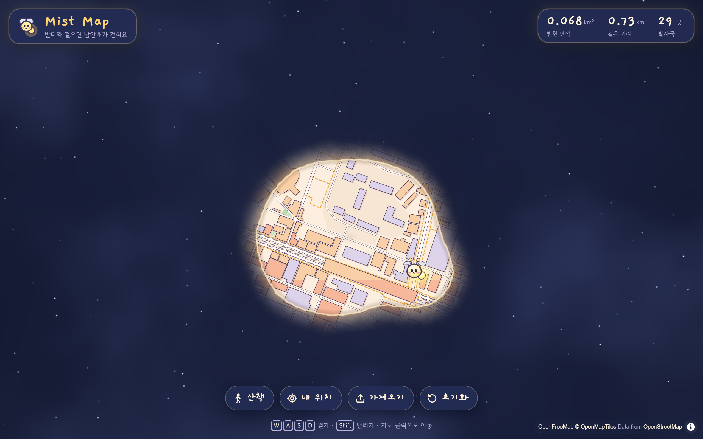
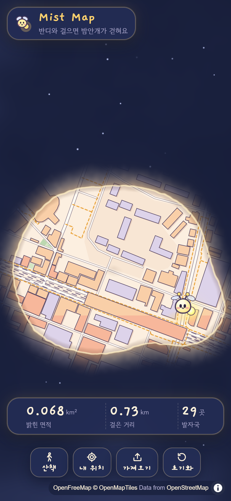

<div align="center">

# ☁️ Mist Map

**반딧불 반디와 걸으면 밤안개가 걷히는 동네 지도**

별이 깔린 남색 밤안개 속을 반딧불의 등불로 밝혀 나가는 탐험 지도의 웹 프로토타입입니다.

### [▶ 라이브 데모 열기](https://jeiel85.github.io/mist-map/)



</div>

## 이런 걸 할 수 있어요

- **걸으면 걷히는 밤안개** — 지나간 자리마다 안개가 스프링처럼 부드럽게 열리고, 경계에는 등불 빛이 숨 쉬듯 번집니다. 안개 위로는 별이 반짝입니다.
- **등불에 비친 동네 지도** — 복숭아·살구색 건물, 크림색 길, 호박색 점선 산책로. 라벨 없이 그림책처럼 그렸습니다.
- **반딧불 캐릭터 반디** — 꼬리 등불을 켠 채 날갯짓하며 떠다니고, 새로 밝힐 때마다 불티가 흩날립니다.
- **다른 앱 기록 가져오기** — 구글 지도 타임라인, Strava·Garmin 같은 앱의 GPX를 넣으면 지금까지 다닌 곳의 안개가 한꺼번에 쓸려 나갑니다.
- **탐험 기록** — 밝힌 면적, 걸은 거리, 발자국 수를 보여 주고, 다시 열면 가까운 곳부터 차례로 기억이 걷힙니다.



## 조작

| 동작 | 방법 |
| --- | --- |
| 걷기 / 달리기 | `W` `A` `S` `D` 또는 방향키 / `Shift` |
| 원하는 곳까지 이동 | 지도 클릭 (모바일은 탭) |
| 자동 산책 | **산책** 버튼 |
| 실제로 걸으며 밝히기 | **내 위치** 버튼 (위치 권한 필요) |
| 다른 앱 기록 넣기 | **가져오기** 버튼, 또는 파일을 화면에 끌어다 놓기 |
| 처음부터 다시 | **초기화** 버튼 |

기록은 사용 중인 브라우저의 `localStorage`에만 저장되고, 위치 정보는 어떤 서버로도 보내지 않습니다.

<br clear="right" />

## 기록 가져오기

| 형식 | 어디서 받나요 |
| --- | --- |
| **구글 타임라인 JSON** | Android: 휴대폰 설정 › 위치 › 위치 서비스 › 타임라인 › *타임라인 데이터 내보내기*<br>iPhone: 구글 지도 앱 › 내 타임라인 › 위치 및 개인정보 보호 설정 › *타임라인 데이터 내보내기*<br>예전 테이크아웃의 `Records.json`, 월별 `Semantic Location History`도 읽습니다 |
| **GPX** | Strava, Garmin Connect 등 대부분의 운동·기록 앱의 내보내기 |
| **KML · GeoJSON** | 구글 내 지도, 지도 편집 도구 등 |

- 이어진 경로는 약 24m 간격으로 채워 넣고, 1.5km 넘게 떨어진 두 점은 잇지 않습니다(기록 공백이나 지하철·비행기 이동).
- 이미 밝힌 곳은 다시 쌓지 않아서 같은 파일을 여러 번 넣어도 늘어나지 않습니다.
- 한 번에 최대 10만 곳까지 가져옵니다.
- 써 볼 파일이 없다면 [`samples/`](samples/)의 서울숲 산책 GPX와 구글 타임라인 샘플을 내려받아 넣어 보세요.

## 어떻게 그리나요

안개는 MapLibre 커스텀 레이어 위에서 WebGL2 셰이더 두 번으로 그립니다.

1. **밝음 필드** — 밝힌 지점마다 가우시안 블롭을 float 텍스처에 더합니다. 가까운 지점끼리는 자연스럽게 녹아 붙습니다.
2. **안개 합성** — 필드로 경계까지의 거리를 추정해 칸을 나눕니다.
   - 안쪽: 지도가 보이고, 가장자리는 불빛이 닿는 끝처럼 살짝 따뜻하게 어두워집니다.
   - 경계: 연기처럼 천천히 일렁이는 밝은 불빛 테.
   - 바깥: 흘러가는 밤안개와 반짝이는 별. 경계 가까이는 등불 빛이 번지고 안개가 옅어져 그 너머가 어렴풋이 비칩니다.
3. **걷힘 애니메이션** — 새 지점의 반경을 살짝 넘쳤다 자리 잡는 스프링 곡선으로 키우면, 불빛이 따라 밀려나며 밤안개가 걷힙니다.

## 로컬에서 실행

빌드 과정 없는 정적 사이트입니다. ES 모듈을 쓰므로 정적 서버로 엽니다.

```bash
python -m http.server 5174
```

`http://localhost:5174`를 열면 됩니다. URL에 `?debug`를 붙이면 콘솔에서 `window.__mist`로 이동을 시뮬레이션할 수 있습니다.

**요구 사항:** WebGL2와 float 렌더 타깃을 지원하는 브라우저 (최신 Chrome · Edge · Safari · Firefox)

가져오기 파서 테스트:

```bash
npm test
```

## 구조

```
index.html        HUD 마크업
src/main.js       캐릭터 이동, 밝히기, 저장, HUD
src/fog.js        안개 커스텀 레이어 (WebGL2 2패스)
src/importers.js  GPX · KML · GeoJSON · 구글 타임라인 파서 (DOM 없이 동작)
src/mapStyle.js   등불에 비친 밤 동네 팔레트 지도 스타일
src/style.css     HUD · 캐릭터 · 애니메이션
tests/            파서 단위 테스트 (node --test)
samples/          가져오기 시험용 샘플 기록
android/          Android 앱 (기록은 네이티브, 그리기는 이 웹 렌더러를 WebView로)
```

## 상태

웹은 안개 표현의 느낌을 확정하기 위한 **프로토타입**입니다.

**Android 앱(M1 기록)** 을 만드는 중입니다. 기록 켜기를 누르면 화면을 꺼도 걸은 길을 기록하고, 앱을 열면 그 길의 안개가 걷혀 있습니다. 앱은 이 저장소의 `index.html`·`src/`를 그대로 렌더러로 씁니다(`?app` 모드). 설계는 [docs/app-architecture.md](docs/app-architecture.md), 주요 결정은 [DECISIONS.md](DECISIONS.md)에 있습니다.

```bash
cd android
./gradlew testDebugUnitTest assembleDebug   # 단위 테스트 + 디버그 APK
```

## 크레딧

- 지도 데이터 © [OpenStreetMap](https://www.openstreetmap.org/copyright) contributors
- 벡터 타일 [OpenFreeMap](https://openfreemap.org) · 스키마 [OpenMapTiles](https://openmaptiles.org)
- 렌더링 [MapLibre GL JS](https://maplibre.org)
- 글꼴 [Gaegu](https://fonts.google.com/specimen/Gaegu), [Gowun Dodum](https://fonts.google.com/specimen/Gowun+Dodum) (앱에 넣은 Gaegu는 SIL OFL 1.1, [android/third_party/Gaegu-OFL.txt](android/third_party/Gaegu-OFL.txt))
