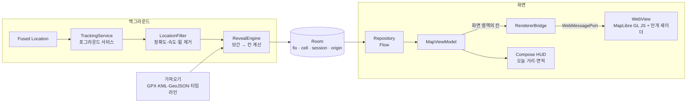
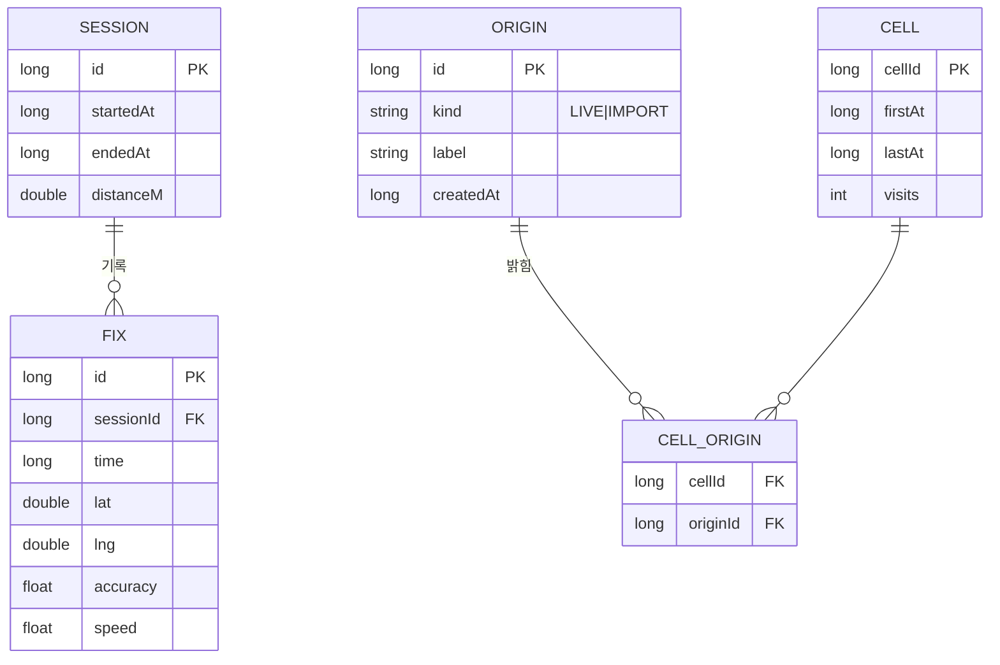

# Mist Map 앱 설계 (백그라운드 위치 기록)

> 상태: **확정** · 2026-10-26 (M1 구현 중) · 되돌리기 어려운 결정은 [DECISIONS.md](../DECISIONS.md)에 따로 적었습니다.
> 구현하면서 달라진 점은 [9장](#9-m1-구현에서-달라진-점)에 모았습니다.

## 1. 무엇을 풀려고 하나

웹 프로토타입은 화면을 켜 둔 동안에만 기록되고, 하루 동선은 다른 앱에서 가져와야 합니다. 앱은 **폰을 주머니에 넣고 다녀도 걸은 곳의 안개가 걷혀 있게** 만드는 것이 목적입니다.

### 성공 기준 (첫 릴리스 전에 실기기에서 잰다)

| 기준 | 목표 | 재는 법 |
| --- | --- | --- |
| 기록 유지 | 기록을 켠 날 8시간 이상 끊기지 않음 (삼성 기기 기준) | 세션 시작·종료 시각, 공백 구간 로그 |
| 배터리 | 걷는 중 시간당 4% 이하, 가만히 있을 때 1% 이하 | Android 배터리 사용량, `dumpsys batterystats` |
| 정확도 | 걷지 않은 곳(지하철·차량·GPS 튐)이 밝혀지는 비율 5% 미만 | 하루 기록을 지도에 겹쳐 눈으로 검수 |
| 실사용 | 1주일 동안 매일 앱을 열어 봄 | 본인 사용 기록 |

마지막 줄이 가장 중요합니다. 기록이 잘 돼도 열어 보고 싶지 않으면 기능을 더 쌓지 않고 표현부터 다시 봅니다.

## 2. 전체 구조

**첫 대상은 Android 하나**입니다. 지금 쓰는 스택(Kotlin · Compose · Room · DataStore)을 그대로 쓰고, iOS는 나중에 같은 구조로 옮깁니다.

핵심은 **기록은 네이티브, 그리기는 웹 프로토타입 재사용**입니다. 안개 셰이더는 이미 마음에 드는 모습이 나왔으니, 그 HTML/JS를 앱에 넣어 WebView로 띄우고 네이티브가 밝힌 칸 데이터를 넘깁니다(근거: DECISIONS D1).



### 저장소 배치

```
mist-map/
├─ index.html, src/        웹 (지금 그대로, GitHub Pages 데모)
├─ android/                새 Android 프로젝트
│  └─ app/src/main/
│     ├─ java/.../
│     │  ├─ tracking/      TrackingService, LocationFilter, 알림
│     │  ├─ reveal/        CellGrid, RevealEngine
│     │  ├─ importers/     Kotlin 파서 (웹과 같은 샘플로 테스트)
│     │  ├─ data/          Room DB, DAO, Repository, DataStore 설정
│     │  ├─ renderer/      WebView 호스트, 브리지
│     │  └─ ui/            Compose 화면 (지도, 오늘, 설정, 가져오기)
│     └─ assets/web/       빌드 시 루트의 index.html·src/를 복사
└─ samples/                웹·앱 파서가 함께 쓰는 테스트 기록
```

웹 코드는 한 벌만 둡니다. Gradle 작업이 빌드할 때 `index.html`과 `src/`를 `assets/web/`로 복사하므로, 셰이더를 고치면 데모와 앱에 함께 반영됩니다.

## 3. 위치 기록

### 기록 방식

| 항목 | 결정 |
| --- | --- |
| 시작 | 사용자가 **기록 켜기**를 누르면 포그라운드 서비스 시작 (`foregroundServiceType="location"`) |
| 권한 | 앱 사용 중 정밀 위치 + 알림만 요청(매니페스트에는 `FOREGROUND_SERVICE_LOCATION`). **항상 허용(백그라운드 위치)은 v1에서 요청하지 않음** (D3) |
| 알림 | "안개를 걷는 중 · 오늘 2.4km" 상시 알림, 알림에서 바로 일시정지·종료 |
| 종료 | 사용자가 끄거나, 자정을 넘겨 6시간 이상 움직임이 없으면 자동 종료 |
| 재부팅 | 자동 재시작 없음. 다음에 앱을 열면 "어제 기록이 끊겼어요" 안내 |

앱 사용 중 권한만으로도 **앱 화면에서 시작한 위치 포그라운드 서비스는 화면을 꺼도 계속 위치를 받습니다.** 항상 허용은 Play 스토어 심사(사용 목적 신고, 시연 영상)가 필요하고 사용자 거부감도 커서, 재부팅 뒤 자동 재개 정도의 이득으로는 아직 감수할 가치가 없습니다.

### 배터리를 아끼는 갱신 주기

| 상태 | 판단 | 위치 요청 |
| --- | --- | --- |
| 걷는 중 | 최근 30초 이동 속도 0.5–3 m/s | 고정밀, 5초 간격, 최소 이동 8m |
| 빠른 이동 | 6 m/s 초과가 1분 이상 | 균형 모드, 30초 간격 (칸은 밝히지 않음) |
| 멈춤 | 3분 동안 반경 30m 안 | 저전력, 2분 간격. 다시 움직이면 걷는 중으로 복귀 |

v1은 속도만으로 판단합니다. 실측했을 때 지하철 구간이 새거나 멈춤 판정이 늦으면, M3에서 Activity Recognition(정지·걷기·차량)을 붙입니다. 이 기능은 신체 활동 권한을 하나 더 받아야 해서 처음부터 넣지는 않습니다.

### 걸러내는 규칙 (`LocationFilter`)

1. 정확도가 35m보다 나쁘면 버림
2. 직전 점에서 계산한 속도가 60 m/s를 넘으면(튐) 버림
3. 직전 점에서 8m 미만이면 저장하지 않음 (제자리 흔들림)
4. 걷기 판단 속도(기본 7 m/s, 설정에서 자전거용으로 조절)를 넘는 구간은 기록만 하고 칸은 밝히지 않음

## 4. 데이터

### 칸(cell): 밝힘의 기준 단위

밝힌 영역은 점이 아니라 **웹 메르카토르 쿼드트리 21단계 칸**(서울 기준 한 변 약 15m)으로 저장합니다(D2). 웹 프로토타입의 중복 제거 격자와 같은 크기여서 그리는 결과가 같습니다.

- 칸 ID는 `(x, y)`를 21비트씩 묶은 `Long` 하나
- 위로 올라가면 4칸이 1칸으로 합쳐지므로, 축소한 화면에서는 상위 단계 칸만 그려 개수를 줄임
- 1km²를 다 걸어도 약 4,400칸이라 수십 km²까지 문제없음

### Room 스키마



- **FIX(원시 위치):** 기록 품질을 조정하고 하루 거리를 다시 계산하려고 **최근 30일만** 보관하고, 그 뒤에는 지웁니다(D4). 칸과 세션 요약은 남습니다.
- **ORIGIN:** 칸이 어디서 왔는지 남겨 둡니다. 가져온 파일을 "되돌리기"하면 그 출처에만 속한 칸이 사라집니다. 웹 이슈 #2의 되돌리기 항목을 앱에서는 처음부터 해결하는 셈입니다.
- **오늘 이동 거리:** `SESSION.distanceM`을 날짜별로 합칩니다. 가져온 기록은 하루 통계에 넣지 않고 총계에만 넣습니다.

### 백업과 내보내기

- Android 자동 백업에는 **칸·세션·출처만** 포함하고 원시 위치(FIX)는 뺍니다. 자세한 동선이 클라우드 백업으로 나가지 않게 하기 위해서입니다.
- 설정에서 **GPX 내보내기**를 제공합니다. 사용자가 자기 기록을 언제든 들고 나갈 수 있어야 합니다.

## 5. 그리기 (WebView 렌더러)

- `assets/web/index.html`을 `WebViewAssetLoader`로 엽니다(`https://appassets.androidplatform.net/...`). ES 모듈과 WebGL2가 그대로 동작합니다.
- 지도 타일은 지금처럼 OpenFreeMap에서 받습니다. 오프라인일 때는 밝힌 칸과 종이 안개만 보이고, 타일 자리에는 "지도를 불러오지 못했어요"를 띄웁니다.
- 웹 쪽에 **앱 모드**를 추가합니다.
  - 키보드 이동·산책·`localStorage` 저장을 끄고, 지점 목록 대신 칸 목록을 받습니다.
  - HUD는 Compose로 그리므로 웹 HUD는 숨깁니다.

| 방향 | 메시지 | 내용 |
| --- | --- | --- |
| 앱 → 웹 | `cells.set` | 화면 영역의 칸 전체 (처음 열 때, 크게 이동했을 때) |
| 앱 → 웹 | `cells.add` | 새로 밝힌 칸 (걷힘 애니메이션 재생) |
| 앱 → 웹 | `player` | 현재 위치, 방향, 걷는 중 여부 |
| 웹 → 앱 | `viewport` | 화면 범위와 줌 (앱이 보낼 칸을 고름) |
| 웹 → 앱 | `ready` · `error` | 렌더러 준비 완료, WebGL2 미지원 등 |

칸 데이터는 `Long` 배열을 `ArrayBuffer`로 넘겨 JSON 직렬화 비용을 피합니다.

**화면이 꺼져 있으면 WebView는 그리지 않습니다.** 기록은 서비스와 DB만으로 돌아가고, 앱을 열면 그동안 밝힌 칸이 차례로 걷히는 연출로 보여 줍니다. 웹의 "다시 오셨네요" 연출과 같은 방식입니다.

## 6. 가져오기

- 웹의 `importers.js`를 Kotlin으로 옮기고, `samples/`와 웹 테스트의 입력을 그대로 써서 같은 결과가 나오는지 JVM 단위 테스트로 확인합니다.
- 파일은 SAF(`ACTION_OPEN_DOCUMENT`)로 고르거나, 다른 앱의 **공유 → Mist Map**으로 받습니다. 구글 지도에서 타임라인을 내보낸 직후 바로 넘길 수 있습니다.
- 파싱과 칸 계산은 `Dispatchers.Default`에서 하고 진행률을 보여 줍니다. 웹 이슈 #2의 "멈춤"과 "진행 표시"를 함께 해결합니다.

## 7. 단계별 계획

| 단계 | 범위 | 끝났다고 보는 기준 |
| --- | --- | --- |
| **M1 기록** | Android 프로젝트, 포그라운드 서비스, 필터, Room 칸 저장, WebView 렌더러 앱 모드, 오늘 거리 HUD | 실기기에서 화면을 끈 채 30분 걷고, 앱을 열면 그 길이 걷혀 있음 |
| **M2 가져오기** | Kotlin 파서와 테스트, SAF·공유 받기, 출처별 되돌리기, GPX 내보내기 | 실제 구글 타임라인 파일 1개 이상을 정상으로 가져옴 |
| **M3 하루 종일** | 배터리 조정, (필요하면) Activity Recognition, 끊김 감지·안내, 제조사 절전 예외 안내 | 1장의 성공 기준 표를 실측으로 충족 |
| 이후 | iOS(같은 웹 렌더러와 WKWebView), 위젯, 기기 간 동기화 | M3 결과와 1주일 실사용을 보고 결정 |

M1 검증은 지침대로 `adb devices`의 실기기를 먼저 쓰고, 없으면 에뮬레이터에서 GPX 경로를 재생해 확인합니다.

## 8. 위험과 대응

| 위험 | 영향 | 대응 |
| --- | --- | --- |
| 제조사 절전(삼성·샤오미)이 서비스를 죽임 | 기록 끊김 | 끊긴 구간을 감지해 다음 실행 때 알리고, 배터리 최적화 예외 설정 화면으로 안내 |
| WebView WebGL 성능이 기기마다 다름 | 버벅임, 발열 | 앱을 쓰지 않을 땐 그리지 않음(웹 이슈 #1의 유휴 렌더 중단을 먼저 처리), 저사양에서는 링 수를 줄임 |
| OpenFreeMap에 SLA가 없음 | 지도가 안 뜸 | 타일 URL을 설정 값으로 분리해 두고, 사용자가 늘면 유료 타일이나 자체 호스팅으로 교체 |
| Play 스토어 위치 정책 | 출시 지연 | 포그라운드 서비스 유형 신고, 개인정보처리방침 페이지 준비, 백그라운드 위치는 쓰지 않음 |
| 위치 기록은 민감 정보 | 신뢰 상실 | 서버 전송 없음, 원시 위치 30일 보관, 자동 백업에서 제외, 내보내기·전체 삭제 제공 |

## 9. M1 구현에서 달라진 점

설계를 그대로 옮기다 어긋나는 부분이 드러나 바꾼 것들입니다. 되돌리기 쉬운 결정이라 여기에만 적습니다.

| 설계 | 구현 | 이유 |
| --- | --- | --- |
| 걷는 중: 최소 이동 8m | 최소 이동 0m, 8m 미만은 `LocationFilter`가 버림 | 최소 이동을 걸면 가만히 있을 때 위치가 오지 않아 "3분 동안 반경 30m" 멈춤 판정을 할 수 없음 |
| 빠른 이동: 균형 모드 30초 | 고정밀 30초 | 균형 모드 위치(정확도 100m 안팎)는 정확도 필터(35m)에 걸러져 걷기로 돌아왔는지 알 수 없음 |
| 멈춤에서 다시 움직이면 걷기로 | 위치가 기준점에서 max(30m, 정확도)를 벗어나면 걷기로 | 위치 오차만큼은 흔들림으로 봄 |
| 멈춤: 저전력 2분 간격 | **고정밀 1분 간격** | 저전력(와이파이·기지국) 위치가 없는 곳에서는 위치가 아예 오지 않아 다시 걸어도 멈춤에서 못 빠져나옴. 에뮬레이터 30분 걷기에서 실제로 뒤 12분이 통째로 빠짐(2026-10-26). 배터리는 M3에서 Activity Recognition으로 다시 줄인다 |
| 칸 계산: 위치 사이 보간 | 걸은 길에 24m마다 표본, 표본마다 칸 하나 (`RevealTrail`) | 위치마다 칸을 찍으면(약 10m 간격) 웹보다 블롭이 촘촘해져 모양이 달라짐 |
| 속도: 직전 점에서 계산 | 직전 **관측점**(흔들림으로 저장하지 않은 점 포함)에서 계산, 거리·흔들림은 마지막 저장점 기준 | 저장점 기준이면 오래 서 있다 차로 떠날 때 머문 시간까지 나눠 걷는 속도로 보이고 그 길이 밝혀짐 (PR #3 리뷰) |
| (없음) | 직전 위치와 10분 넘게 떨어지면 잇지 않고 새로 출발 | 멈춤 모드의 긴 간격이나 신호 끊김 사이를 직선으로 밝히지 않도록 |
| 오늘 이동 거리 | 오늘 **걸은** 거리 (7 m/s 넘는 구간 제외), 자정에 세션을 나눔 | 차량 이동이 "걸은 거리"에 섞이지 않게, 날짜별 합계를 세션 시작일로 바로 구하게 |
| `FIX` 테이블 | 별도 DB 파일 `fixes.db` | 자동 백업에서 파일 단위로 빼기 위해 (D4) |
| 앱 → 웹 `viewport`로 화면 영역 칸만 보냄 | 연결될 때 칸 전체(`cells.set`), 이후 새 칸(`cells.add`) | 수십 km²까지는 칸 수가 적어(1km²에 약 4,400칸) 웹이 프레임마다 화면 밖 칸을 건너뛰는 것으로 충분. 칸이 많아지면 다시 봄 |
| 웹 → 앱 메시지 | `ready`, `error`만. 앱 → 웹에 `insets`(HUD가 가리는 높이) 추가 | 캐릭터를 보이는 영역 가운데에 두고 따라가기 버튼·저작권 표시를 HUD 위로 올리려고 |

### 검증 (2026-10-26, 에뮬레이터 API 36)

- 권한 요청(앱 사용 중 위치 + 알림) → 기록 켜기 → 포그라운드 서비스(type=location) 확인
- GPS 경로 재생(3초마다 6m) 중 화면을 끄고 540m 걸음 → 앱을 열면 그 길이 걷혀 있음, 오늘 0.54km
- 알림에서 "끄기" → 서비스 종료·세션 닫힘. 앱 재설치로 기록 중 프로세스를 죽이면 다음 실행 때 열린 세션을 닫음
- 300m 걷기에 새 칸 13개 (24m 간격과 일치)
- **실기기 30분 걷기(M1 완료 기준)는 아직 하지 않았습니다.** 연결된 기기가 없어 에뮬레이터로 갈음했습니다.

## 10. M2 가져오기 구현 (2026-10-26)

| 항목 | 구현 |
| --- | --- |
| 파서 | `importers/HistoryParser.kt` — 웹 `src/importers.js`를 그대로 옮김. JSON은 `kotlinx-serialization-json`(JVM 테스트 가능), XML은 웹과 같은 정규식 |
| 같은 결과 확인 | `HistoryParserTest`가 `tests/importers.test.js`와 같은 입력·기대값, `samples/` 두 파일은 웹 파서(node) 결과와 비교 |
| 칸 계산 | `ImportPlanner` — 실시간 기록과 같은 24m 표본(`RevealTrail`), 1.5km 넘게 떨어진 두 점은 잇지 않음(웹과 같음) |
| 저장 | 파일 하나가 `ORIGIN(kind=IMPORT)` 하나. 새 칸의 `firstAt`은 가져온 시각이라 화면이 새 칸으로 알아보고 걷어 냄. 오늘 걸은 거리에는 넣지 않음 |
| 되돌리기 | 그 출처에만 속한 칸만 지움(걸어서 밝힌 칸·다른 파일과 겹친 칸은 남음). 지운 뒤 렌더러에 칸 전체를 다시 보냄 |
| 받는 길 | "기록 모음" 시트의 파일 고르기(SAF, 모든 형식 → 내용으로 판별), 다른 앱의 공유(`ACTION_SEND`), 파일 앱의 열기(`ACTION_VIEW`) |
| 내보내기 | 원시 위치(최근 30일, D4)를 세션별 트랙으로 GPX 1.1에 씀. 내보낸 파일은 우리 파서로 다시 읽힘(테스트) |
| 크기 제한 | 힙의 1/16(최대 32MB, 힙 192MB 기기에서 12MB). 크기를 알면 읽기 전에, 모르면 읽다가 넘는 순간 멈추고 기간을 나눠 넣으라고 안내. 그래도 메모리가 모자라면 OutOfMemoryError를 잡아 같은 안내 (PR #5 리뷰) |
| 카메라 | 가져오면 웹 렌더러에 `{type:'fit'}`을 보내 기록 범위로 이동. 공유로 앱이 막 열려 렌더러가 없으면 연결될 때 맞춤 |

### 검증 (에뮬레이터 API 36)

- 문서 선택기로 `samples/google-timeline-sample.json` → 80칸, `samples/seongsu-walk.gpx` → 195칸. 서울숲 산책 길이 밤안개 사이로 드러나고 오늘 걸은 거리는 그대로
- 타임라인 되돌리기 → 80칸 중 겹치지 않은 79칸만 사라짐
- GPX 내보내기 → 두 세션 57개 지점, 파일을 열어 형식 확인
- 실제 구글 타임라인 내보내기 파일 대신 샘플(알려진 구조로 만든 파일)로 확인했고, 사용자가 이것으로 M2 완료를 받아들였습니다(2026-10-26). 실제 파일을 받으면 한 번 더 확인합니다.

## 11. 에뮬레이터 30분 걷기와 간단히 보기 (2026-10-26)

사용자 요청으로 M1 완료 기준을 에뮬레이터에서 실제 시간으로 확인했습니다.

| 시험 | 결과 |
| --- | --- |
| 화면 끈 채 31분: 15분 걷기 → 4분 멈춤 → 12분 걷기 (1.4m/s) | 앞 15분 1,257m는 정확히 기록, 앱을 열면 길이 걷혀 있음. **멈춤 모드에서 빠져나오지 못해 뒤 12분이 빠짐** |
| 원인 | 멈춤 모드가 저전력(와이파이·기지국) 위치를 요청했는데, 그런 위치가 없는 환경에서는 위치가 아예 오지 않음 |
| 수정 후 재시험: 3분 걷기 → 4분 멈춤 → 4분 걷기 | 멈춤 진입 3분 뒤, 다시 걷기 시작 약 1분 뒤 걷기 모드로 복귀. 588m 중 580m 기록 |
| 알림 | 위치마다 다시 게시하던 것(31분 121번)을 0.1km가 바뀔 때만으로(11분 6번) |
| 배터리 | 에뮬레이터 전력 추정은 의미가 없음(31분 0.03mAh). 시간당 %는 실기기에서만 잴 수 있음 |

### 간단히 보기 (걷는 동안 절전 화면)

- 기록 중 1분 동안 손대지 않으면 들어가고, 왼쪽 위 "간단히 보기"로 바로 들어갈 수도 있습니다. 화면을 누르거나 뒤로 가기를 누르면 지도로 돌아옵니다.
- 지도·안개(WebView WebGL)를 멈추고 화면 밝기를 0.08로 낮춥니다. 거의 검은 바탕에 오늘 걸은 거리와 숨 쉬는 불빛만 보입니다.
- 불빛은 약 4초 주기로 숨 쉬되 초당 10번만 값을 바꾸고 그리기 단계만 다시 합니다(재구성 없음).

## 12. M3 하루 종일 기록 구현 (2026-10-26)

| 항목 | 구현 |
| --- | --- |
| 위치 요청 방식 | `MotionPolicy`가 속도 분류와 활동 인식을 합쳐 정함: 걷기(고정밀 5초) · 빠른 이동(고정밀 30초) · 멈춤(고정밀 1분, 활동 인식이 없을 때) · **쉬기(GPS 끔)** |
| 활동 인식 | 전환 API(정지·걷기·달리기·자전거·차량의 들어감/나옴). "정지"면 쉬기, "차량"이면 빠른 이동, 걷기·자전거가 들어오면 깨어남 |
| 권한 | 기록을 켤 때 신체 활동 권한을 함께 물음. **거부해도 기록은 됨**(속도 분류만, M2까지와 같음) |
| 쉬는 동안 확인 | 10분마다 위치를 한 번만 받아 마지막 위치에서 100m 넘게 옮겨졌으면 깨움(활동 인식이 놓친 이동) |
| 끊김 감지 | 위치가 2분(멈춤 3분) 넘게 안 오면 알림에 "위치를 받지 못하고 있어요". 위치가 다시 오거나 쉬기로 들어가면 내림 |
| 오늘 기록 상태 | 기록 모음 시트에 기록한 시간 · GPS를 켠 시간 · 쉰 시간 · 끊긴 횟수. 기기 안(SharedPreferences)에만, 오늘·어제 값만 둠 |
| 절전 예외 안내 | 배터리 최적화 대상이면 상태 카드에 "앱 정보 › 배터리 › 제한 없음(삼성)/최적화 안 함" 안내와 앱 정보 열기. 끊긴 기록 안내에서도 시트로 이어짐 |

### 검증 (에뮬레이터 API 36)

- 기록 켜기 때 신체 활동 권한 대화상자 → 허용 → 활동 인식 등록
- 위치 서비스를 꺼서 2분 → 알림 "오늘 2.6km · 위치를 받지 못하고 있어요"
- 에뮬레이터에서도 가만히 두자 활동 인식이 "정지"를 보내 쉬기(GPS 끔)로 바뀜 → 이때 끊김 경고가 남던 문제를 찾아 고침
- 이동 정책은 단위 테스트(`MotionPolicyTest`)
- **쉬기에서 깨어나는 경로(10분 확인 → 100m 넘게 옮겨졌으면 깨움)는 에뮬레이터로 확인하지 못했습니다.** 에뮬레이터의 활동 인식이 "정지"를 두 번 시도에서 보내지 않았습니다. 정책의 `wake()`만 단위 테스트로 확인했고, 서비스 쪽은 실기기에서 봐야 합니다
- 위치 서비스를 껐다 켜면 기록이 저절로 이어지고(멈춤 → 300m 이동 → 걷기), 멈춤 중 3분 넘게 끊기면 경고가 뜨는 것도 확인
- **배터리 %와 8시간 연속 기록은 실기기에서만 잴 수 있습니다.** 오늘 기록 상태 카드와 Android 배터리 사용량 화면으로 재면 됩니다.

## 13. 하드닝 정리 (2026-10-27)

이슈 #1·#2·#4·#6·#8과 BACKLOG 항목을 한 번에 정리했다. 실기기 확인은 사용자 요청으로 에뮬레이터(API 36)로 대신했다.

| 항목 | 처리 |
| --- | --- |
| 오프라인 렌더러 | MapLibre GL JS 4.7.1을 `vendor/`에 넣고 앱 자산에도 복사. 네트워크를 끄고 열어도 밤안개와 밝힌 칸이 그려지고 오류 카드가 뜨지 않음(타일은 WebView 캐시에 있는 만큼) |
| 많은 칸 그리기 | 칸을 z14 타일 묶음으로 색인해 화면 안 묶음만 훑음. 크게 축소하면 가까운 블롭을 하나로 합침(최소 3px). 20만 칸: 첫 로드 약 1초, 프레임 z16 0.2ms · z10 3~5ms. 앱→웹으로 화면 영역만 보내는 방식은 로드가 1초라 하지 않음 |
| 축소 화면 | 크게 축소하면 경계 흔들림·안개 무늬가 화면 px보다 잘아져 모래알처럼 보이던 것을 줌에 따라 줄임(z14 이상은 그대로) |
| 웹 저장 | `mistmap:v2` 압축 형식(정수 좌표 + 출처), v1은 읽어서 옮김. 400만 자를 넘으면 한 번 경고 |
| 웹 가져오기 | 워커에서 파싱(진행률 표시), 파일별 되돌리기, 큰 범위는 최소 줌 4까지 맞춤 |
| 이동 수단 필터 | 구글 타임라인의 차량·비행·배 구간(`IN_*`, FLYING 등) 안의 점을 빼고 길을 끊음. 웹·앱 파서 둘 다 |
| 앱 큰 파일 | 받은 URI를 앱 캐시로 먼저 복사(공유 권한 수명 문제 해결) 뒤 gson으로 스트리밍 파싱. 진행률 % · 취소 |
| 되돌리기 | Room 쿼리를 Robolectric 테스트로, 되돌린 뒤 12초 동안 "되살리기". 파일 이름은 백업되지 않는 SharedPreferences에만 |
| 내보내기 | GPX에 가져온 칸 중심을 웨이포인트로 넣어, 다른 기기에서 다시 가져오면 같은 곳이 밝혀짐 |
| 일시정지 | 상태를 저장해, 일시정지 중 프로세스가 죽으면 "끊김"으로 안내하지 않음 |
| 처음 연 화면 · 설정 | 처음 한 번 안내. 간단히 보기 진입 시간 30초·1분·3분·끄기 |
| 밝기 | 간단히 보기에서 조도 센서가 1000lx 이상(낮 야외)이면 밝기를 낮추지 않음 |
| 알림 권한 거부 | 기록을 켤 때 "기록 중 표시가 보이지 않아요" 안내와 설정 열기 |
| 끊김 · 쉬기 | `GapMonitor`로 분리(단위 테스트), 끊긴 시각 최근 10번을 상태 카드에. 쉬는 중 확인 10분 → 5분 |
| 새 칸 감지 | 칸 `firstAt`을 기기 시계 순서로 매겨 위치 시각이 앞서도 화면에 바로 나타남 |

### 에뮬레이터 검증에서 찾아 고친 것

- **첫 실행 크래시**: `MapViewModel`의 `init` 코루틴이 시작이 끝나 있으면 바로 실행돼, 아래에 선언된 `settings`가 아직 null이었다. 설정 속성을 `init` 위로 옮김
- **되살리기를 누를 수 없음**: 되돌리기 안내가 기록 모음 시트의 흐림막 뒤에 떠서, 누르면 시트만 닫혔다. 되돌리기를 확정하면 시트를 닫고, 행동이 있는 안내는 12초 보이게 함

### 확인한 것

첫 실행 안내, 간단히 보기 설정 저장, 타임라인 가져오기(지하철 구간이 빠져 두 덩어리로), GPX 가져오기 → 되돌리기 → 되살리기, 내보내기 파일의 웨이포인트 195개, 오프라인 실행, 일시정지 중 강제 종료(안내 없음) / 기록 중 강제 종료(끊김 안내), 알림 권한 거부 안내. **배터리 %는 에뮬레이터로 잴 수 없어 BACKLOG에 남김.**

## 14. 끊긴 곳 표시 · 쉬는 중 곁에서 듣기 (2026-10-27)

에뮬레이터로 할 수 있는 BACKLOG 항목을 마저 정리했다.

| 항목 | 바꾼 것 |
|---|---|
| 끊긴 곳 지도 표시 | 끊긴 시각과 함께 그 직전 위치(이번 기록에서 받아들인 마지막 위치, 소수 5자리)를 기기 안 `Diagnostics`에 남긴다. 기록 모음의 시각을 누르면 시트가 닫히고 지도가 그 자리로 가서 꺼진 등불 표시를 띄운다. 표시는 누르거나 '따라가기'를 누르면 사라진다. 예전 형식("HH:mm"만)도 읽는다 |
| 앱 → 웹 메시지 | `{type:'mark', lng, lat, label}` 추가. `lng`가 없으면 표시를 지운다. `tools/app-mode.cjs`가 카메라 이동·표시·지우기를 점검 |
| 쉬는 중 확인 | 5분마다 직접 확인하는 것에 더해, 다른 앱이 받은 위치를 곁에서 듣는다(`PRIORITY_PASSIVE`, 30초에 한 번까지). GPS를 따로 켜지 않아 배터리를 더 쓰지 않는다. 정확도 50m보다 나쁜 위치(와이파이·기지국)로는 깨우지 않는다. 판단은 `SleepWake`로 떼어 단위 테스트 |

- 쉬다 깨어날 때 첫 위치를 잠들기 전 점과 직선으로 잇지 않는 것은 원래 그랬다(`requestUpdates`에서 필터·궤적 초기화). 활동 인식이 놓쳤을 때의 손해는 직선이 아니라 **깨기 전까지 걸은 길이 밝혀지지 않는 것**이고, 곁에서 듣기로 그 시간을 줄인다.
- 에뮬레이터 확인: 걷다가 위치 서비스를 끄자 198초 뒤 끊김으로 잡히고 마지막 위치가 저장됐다. 기록 모음에서 그 시각을 누르면 지도가 그 자리로 가서 표시가 뜬다.
- **곁에서 듣기로 실제로 일찍 깨는지는 확인하지 못했다.** 에뮬레이터의 활동 인식이 '정지'를 안정적으로 내주지 않아 쉬기 상태에 들어가지 못한다. 실기기 배터리 실측 때 함께 본다.
